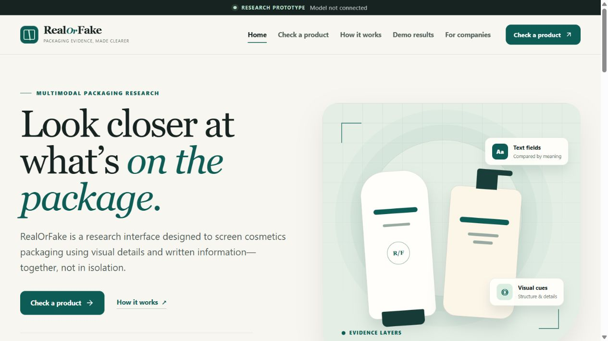
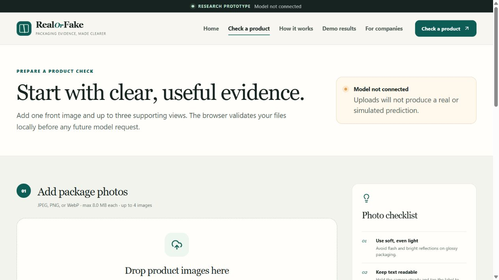
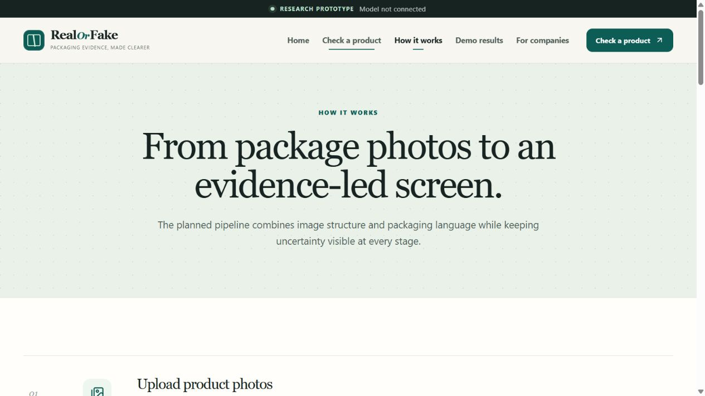
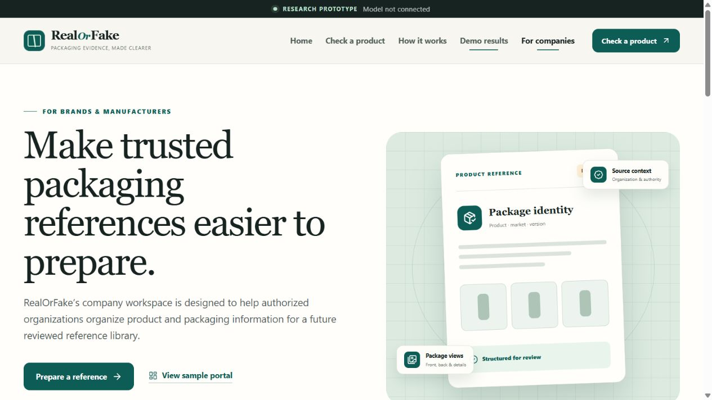
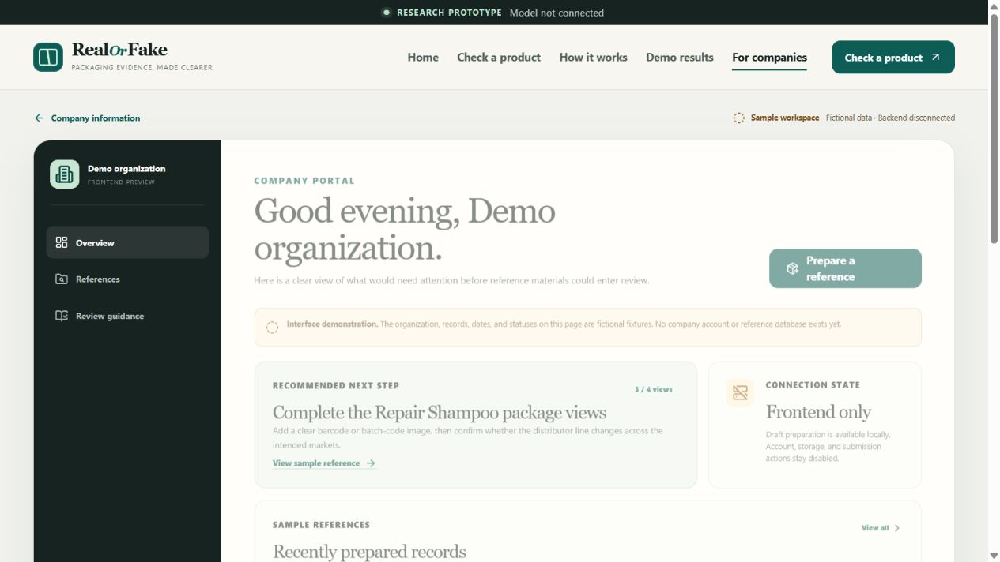
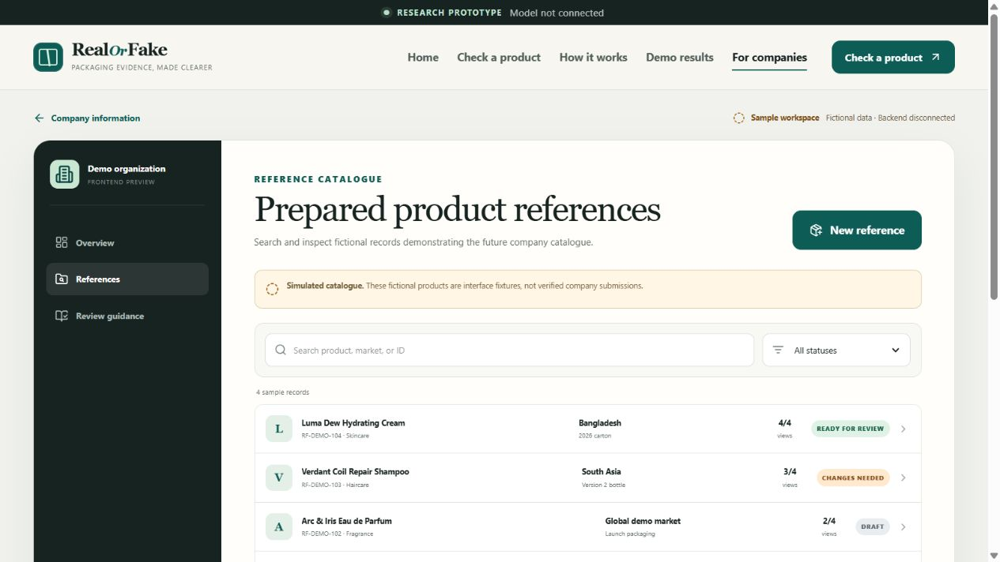
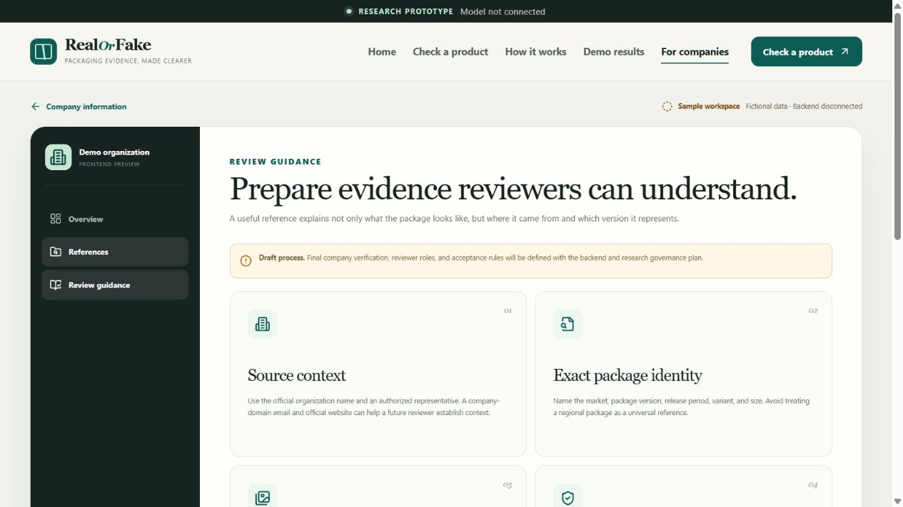
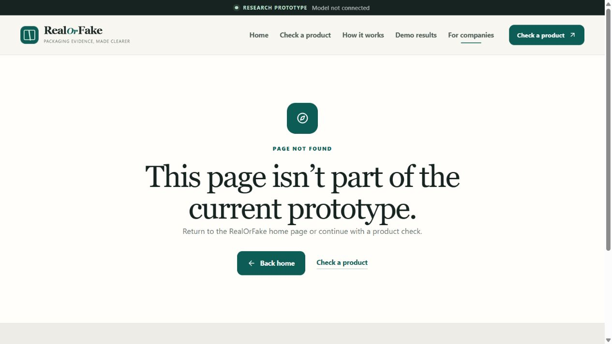
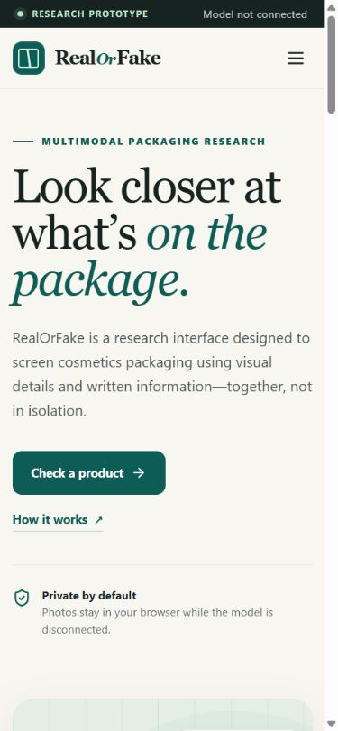
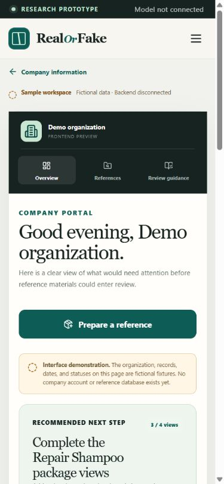

# RealOrFake

RealOrFake is the frontend prototype for the Final Year Design Project **“A Multimodal Approach to Product Legitimacy Analysis in the Cosmetics Industry.”** It is designed to screen cosmetic-product packaging through image and packaging-text evidence.

The repository currently contains a frontend only. **No machine-learning model is connected, and ordinary uploads never generate a simulated authenticity prediction.** Fixed fictional fixtures live in a separate “Explore demo results” area.

**Live interface:** [hasibur303.github.io/RealOrFake](https://hasibur303.github.io/RealOrFake/)

## What is included

- Responsive React, TypeScript, Vite, and Tailwind CSS interface
- Home, product-check, research, demo-result, and company-workspace views
- Drag-and-drop and file-picker upload paths
- Local image previews with view labels, file details, removal, and replacement
- JPEG, PNG, WebP, file-size, image-readability, and upload-count validation
- Product category and optional reference-selection details
- Typed request, response, and error contracts for a future inference service
- Explicit loading, error, unavailable-service, ready, and completed-result states
- Fixed fictional result fixtures for likely-genuine, suspicious, and insufficient-evidence layouts
- Guided four-step company reference preparation flow for brands, manufacturers, authorized distributors, and research or regulatory organizations
- Browser-memory-only company drafts with organization, market, package-version, image, rights-confirmation, review, and completion states
- Functional sample company portal with overview, searchable reference catalogue, record details, preparation statuses, review guidance, filter and empty states
- Intentional not-found route instead of silently redirecting invalid URLs
- Unit tests for validation and response-state handling
- GitHub Pages deployment workflow with a repository-aware base path

## Interface screenshots

The report-ready JPG files are stored in [`docs/screenshots`](docs/screenshots). They show fictional sample content and the deliberately disconnected frontend state.

| Home | Check a product |
| --- | --- |
|  |  |

<details>
<summary>View the complete desktop and responsive screenshot set</summary>

### Research approach



### Demo results


### Company workspace



### Company portal overview



### Company reference catalogue



### Company review guidance



### Not-found state



### Mobile home



### Mobile company portal



</details>

## Local development

Requirements: Node.js 22 or newer and npm.

```bash
npm install
npm run dev
```

Then open the local URL printed by Vite.

## Verification

```bash
npm test
npm run lint
npm run build
```

The production output is written to `dist/`.

## Configuration

Copy `.env.example` to `.env.local` when a backend becomes available:

```bash
cp .env.example .env.local
```

| Variable | Purpose |
| --- | --- |
| `VITE_API_BASE_URL` | Public base URL of the future inference API. Leave empty to keep the model disconnected. |
| `VITE_MAX_FILE_SIZE_MB` | Maximum size of each selected image. Defaults to `8`. |
| `VITE_BASE_PATH` | Vite asset base. The Pages workflow sets this automatically. |

Do not place secrets in any `VITE_` variable. Vite exposes those values to every visitor’s browser.

## Privacy and frontend limitations

- Selected photos remain in browser memory while the backend URL is unconfigured.
- The frontend uses object URLs for previews and revokes them when images are removed, replaced, or the page unmounts.
- The app has no database, user account, analytics, image storage, or model runtime.
- Demo results are fixed fictional data. They are always labelled “Simulated” and are not connected to visitor uploads.
- A future result supports authenticity screening only. It must not be represented as certification of authenticity, product safety, or regulatory compliance.
- Text similarity is a semantic-alignment measure, not a probability that a product is genuine.

## Draft backend API contract

This contract is a proposal and may change when the model service is implemented.

### Request

`POST {VITE_API_BASE_URL}/v1/analyze`

Content type: `multipart/form-data`

| Field | Type | Description |
| --- | --- | --- |
| `images` | repeated binary file | One to four JPEG, PNG, or WebP files. |
| `imageViews` | JSON string | Ordered array matching `images`, using `front`, `back`, or `detail`. |
| `product` | JSON string | `{ category, brand?, variant?, packageSize? }`. |

The current client timeout is 45 seconds. Authentication and rate limiting should be implemented by the backend or an appropriate server-side gateway; never ship an API secret in the frontend.

### Successful response

```json
{
  "requestId": "request-id",
  "outcome": "likely-genuine | suspicious-packaging | insufficient-evidence | unsupported-product",
  "summary": "Concise evidence-led summary",
  "reasons": ["Reason"],
  "suggestedNextSteps": ["Action"],
  "imageQuality": [
    { "imageId": "front-1", "view": "front", "usable": true, "issues": [] }
  ],
  "imageModel": {
    "label": "Optional model label",
    "score": 0.82,
    "notes": ["Optional model note"]
  },
  "extractedText": [
    { "text": "Detected text", "confidence": 0.94, "sourceView": "front" }
  ],
  "referenceMatch": {
    "referenceName": "Reference label",
    "market": "Market",
    "packagingVersion": "Version",
    "textSimilarity": 0.78
  },
  "fieldMismatches": [
    { "field": "Package size", "observed": "49 mL", "expected": "50 mL", "severity": "warning" }
  ],
  "missingInformation": ["Readable batch code"],
  "modelVersion": "model-version",
  "createdAt": "2026-01-01T00:00:00.000Z"
}
```

Optional values and unavailable scores should be omitted, not invented or filled with zeroes. The frontend validates that core arrays and outcome fields are present before rendering a response.

### Errors

The service should return a suitable HTTP status and a stable error body for unavailable services, timeouts, rejected files, unsupported products, and incomplete analysis. The frontend error codes are:

- `SERVICE_UNAVAILABLE`
- `TIMEOUT`
- `REJECTED_FILE`
- `UNSUPPORTED_PRODUCT`
- `INCOMPLETE_RESPONSE`
- `NETWORK_ERROR`

## GitHub Pages

1. Create or choose a GitHub repository and push this project to its `main` branch.
2. In **Settings → Pages**, set **Source** to **GitHub Actions**.
3. The workflow in `.github/workflows/deploy-pages.yml` installs, tests, builds, and deploys the `dist/` directory.

The workflow supplies `VITE_BASE_PATH=/<repository-name>/`, so asset URLs work on a project Pages site. Hash-based routing keeps direct navigation compatible with static hosting.

## Repository hygiene

The ignore rules exclude dependency folders, builds, local environment files, logs, and editor metadata. Do not commit datasets, uploaded photos, credentials, model weights, or generated `node_modules/` content.
